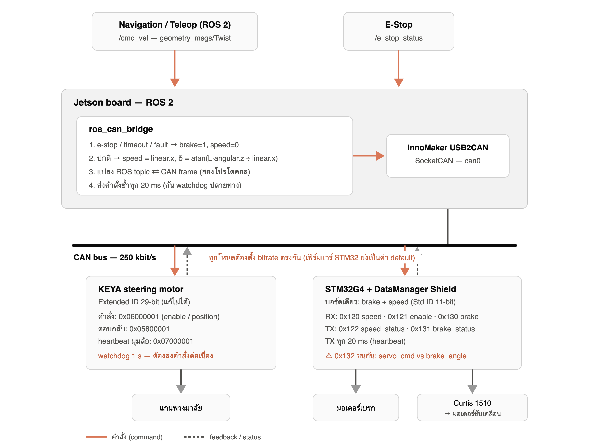

<div align="center">

# 🛺 3D Mapping & Autonomous Golf Cart — INC31 KMUTT

ทำแผนที่ 3 มิติ · หาตำแหน่งบนแผนที่ · ขับรถกอล์ฟอัตโนมัติตามเส้นทาง


</div>

---

## 📚 งานทั้งหมดในโปรเจกต์

| | Repo | ทำอะไร |
|---|---|---|
| 🗺️ | **[Mapping](https://github.com/Pakgard007/Mapping)** ← *หน้านี้* | เก็บแผนที่ 3 มิติด้วย LIO-SAM + LiDAR + GPS RTK |
| 📍 | **[Localize_get_path](https://github.com/Pakgard007/Localize_get_path)** | หาตำแหน่งรถบนแผนที่ (NDT) และขับตามเส้นทาง (Pure Pursuit + CBF-QP) |
| 💾 | **[golfcart-maps](https://github.com/Pakgard007/golfcart-maps)** | ไฟล์แผนที่ `.pcd` ที่เก็บได้ (โหลดจาก [Releases](https://github.com/Pakgard007/golfcart-maps/releases)) |

```text
 ┌──────────── Mapping ────────────┐      ┌─ golfcart-maps ─┐      ┌──────────── Localize_get_path ────────────┐
 │ Ouster + IMU + GPS RTK + ล้อ     │      │                 │      │ Ouster ──► NDT localization ──► /pcl_pose │
 │        └──► LIO-SAM ──► save_map├─────►│ FullGlobalMap   ├─────►│ nav_path ──► Pure Pursuit + CBF-QP        │
 └─────────────────────────────────┘      │      .pcd       │      │        └──► /cmd_vel ──► CAN ──► รถวิ่ง   │
                                          └─────────────────┘      └───────────────────────────────────────────┘
```

## 📑 สารบัญ

1. [ภาพรวมระบบ](#-ภาพรวมระบบ)
2. [ฮาร์ดแวร์](#-ฮาร์ดแวร์)
3. [โครงสร้าง repo นี้](#-โครงสร้าง-repo-นี้)
4. [ติดตั้งและ build](#-ติดตั้งและ-build)
5. [ขั้นที่ 1 — ทำแผนที่](#-ขั้นที่-1--ทำแผนที่)
6. [ขั้นที่ 2 — Localization และขับรถอัตโนมัติ](#-ขั้นที่-2--localization-และขับรถอัตโนมัติ)
7. [ระบบควบคุมรถ (Low-level / CAN / Firmware)](#-ระบบควบคุมรถ-low-level--can--firmware)
8. [การตั้งค่าที่สำคัญ](#-การตั้งค่าที่สำคัญ)
9. [เอกสารประกอบ](#-เอกสารประกอบ)
10. [แก้ปัญหาเบื้องต้น](#-แก้ปัญหาเบื้องต้น)
11. [เครดิต](#-เครดิต)

---

## 🔭 ภาพรวมระบบ

ระบบแบ่งเป็น 2 ช่วง ใช้คนละ workspace:

1. **ทำแผนที่ (repo นี้)** — ขับรถกอล์ฟเก็บข้อมูล LiDAR, IMU, GPS RTK และความเร็วล้อ
   LIO-SAM รวมทั้งหมดเป็นแผนที่ point cloud ที่ยึดกับพิกัดโลก แล้วเซฟเป็น `.pcd`
2. **ใช้งานแผนที่ ([Localize_get_path](https://github.com/Pakgard007/Localize_get_path))** — โหลดแผนที่
   เทียบกับสแกนสดด้วย NDT เพื่อรู้ตำแหน่งรถ แล้วขับตามเส้นทางที่กำหนด

```text
Ouster OS-1-128 ─┐ /ouster/points, /ouster/imu
                 ├──► LIO-SAM ──► แผนที่ + เส้นทาง ──► save_map ──► ~/Downloads/LOAM/*.pcd
u-blox ZED-F9R ──┤ /ublox_gps_node/fix
   ▲ /rtcm       │
NTRIP client ────┘
CAN (STM32, KEYA) ──► golfcart_low_level ──► /speed_status (ความเร็วล้อ ช่วย LIO-SAM)
```

## 🔧 ฮาร์ดแวร์

| อุปกรณ์ | รุ่น | เชื่อมต่อ |
|---|---|---|
| LiDAR | Ouster OS-1-128 (1024×10 Hz) | LAN `192.168.1.100` |
| GNSS | u-blox ZED-F9R (C102-F9R) + NTRIP RTK | USB `/dev/ttyACM*` |
| CAN adapter | InnoMaker USB2CAN | `can0` @ 250 kbit/s |
| คันเร่ง / เบรก | บอร์ด STM32G474 (car shield) | CAN |
| พวงมาลัย | มอเตอร์ KEYA | CAN 29-bit |
| คอมพิวเตอร์ | Jetson · Ubuntu 22.04 · ROS 2 Humble | — |

<details>
<summary><b>ขนาดรถและตำแหน่ง LiDAR</b> (จาก <code>src/mapping_rviz_panel/cart/cart.yaml</code>)</summary>

| ค่า | ขนาด |
|---|---|
| Wheelbase | 1.65 m |
| ยาว × กว้าง | 2.8 × 1.3 m |
| LiDAR หน้าเพลาหลัง | 1.53 m |
| LiDAR สูงจากพื้น | 1.80 m |
| ทิศหน้ารถ | −x ของ `lidar_link` |

</details>

## 📁 โครงสร้าง repo นี้

| โฟลเดอร์ / ไฟล์ | หน้าที่ |
|---|---|
| `src/LIO-SAM-ROS-Humble-main/` | LIO-SAM (`lio_sam`) ปรับให้ใช้กับ Ouster 128 ช่อง, รับ GPS `NavSatFix` ตรงๆ และรวมความเร็วล้อจาก CAN |
| `src/mapping_rviz_panel/` | หน้าต่าง RViz ทำแผนที่: ปุ่มเปิด/ปิดแต่ละขั้น, ปุ่มเซฟแผนที่, โมเดลรถกอล์ฟขนาดจริง |
| `src/ouster-ros/` | ไดรเวอร์ Ouster LiDAR |
| `src/ublox/` | ไดรเวอร์ GNSS u-blox |
| `src/ntrip_client/` | NTRIP client ดึงค่าแก้ RTCM3 จาก VRS caster ส่งให้ u-blox |
| `src/golfcart_low_level/` | ROS 2 ↔ CAN ไปบอร์ด STM32 และพวงมาลัย KEYA — [README](src/golfcart_low_level/README.md) |
| `firmware/stm32_motorbrake_car_shield/` | เฟิร์มแวร์ STM32G474 ควบคุมความเร็วและเบรก (STM32CubeIDE) |
| `docs/` | เอกสาร: สไลด์การเก็บแผนที่, ภาพรวม low-level, ตัวอย่างสั่งเบรก |
| `192.168.1-metadata.json` | metadata ของ Ouster OS-1-128 |
| `start_cart.sh` | เปิดระบบขับรถทั้งชุดตามลำดับ (ใช้ร่วมกับ Localize_get_path) |
| `cart_env.sh` | `source` เพื่อเตรียม shell สำหรับขับรถ และเช็กว่าแพ็กเกจมาจาก workspace ไหน |

## 📦 ติดตั้งและ build

```bash
# ต้องมี ROS 2 Humble ก่อน
git clone git@github.com:Pakgard007/Mapping.git ~/1Mapping
cd ~/1Mapping
rosdep install --from-paths src --ignore-src -r -y
sudo apt install -y python3-can can-utils python3-aenum
colcon build --symlink-install --cmake-args -DCMAKE_BUILD_TYPE=Release
source install/setup.bash
```

> `build/`, `install/`, `log/` ไม่ได้อยู่ใน git ต้อง build เองหลัง clone
> ชื่อโฟลเดอร์ต้องเป็น `~/1Mapping` เพราะสคริปต์และ panel อ้าง path นี้

<details>
<summary><b>🔑 ตั้งค่าบัญชี NTRIP</b> (ต้องทำก่อนใช้ RTK)</summary>

username/password ของ NTRIP **ไม่ได้อยู่ใน git** ให้สร้าง `src/ntrip_client/config/ntrip.local.yaml`
(อยู่ใน `.gitignore`) แล้ว build ใหม่ — launch จะโหลดไฟล์นี้ทับ `ntrip.yaml` ให้เอง

```yaml
ntrip_client:
  ros__parameters:
    username: "<username>"
    password: "<password>"
```

</details>

---

## 🧭 ขั้นที่ 1 — ทำแผนที่

### แบบใช้ Mapping Panel (แนะนำ)

```bash
source /opt/ros/humble/setup.bash
source ~/1Mapping/install/setup.bash
ros2 launch mapping_rviz_panel mapping_panel.launch.py      # theme:=false = หน้าตา RViz แบบเดิม
```

กดเปิดทีละขั้นในแผง **Mapping** (แต่ละขั้นเปิดใน terminal ของตัวเอง):

| # | ปุ่ม | คำสั่งที่รัน |
|---|---|---|
| 1 | LiDAR Ouster | `ros2 launch ouster_ros driver.launch.py` |
| 2 | LIO-SAM | `ros2 launch mapping_rviz_panel lio_sam.launch.py` |
| 3 | Low-level | ระบบ CAN ของรถ → ความเร็วล้อ `/speed_status` |
| 4 | GPS u-blox | `ros2 launch ublox_gps ublox_gps_node_zed_f9r-launch.py` |
| 5 | NTRIP (RTK) | `ros2 launch ntrip_client ntrip_client-launch.py` |

ขับรถเก็บข้อมูลให้ทั่วพื้นที่ แล้วกด **เซฟแผนที่** → ไฟล์อยู่ที่ `~/Downloads/LOAM/`

> ⚠️ แผนที่อยู่ในหน่วยความจำจนกว่าจะเซฟ ถ้าหยุด LIO-SAM ก่อนเซฟต้องเริ่มใหม่ทั้งหมด

<details>
<summary><b>แบบสั่งเองทีละคำสั่ง</b></summary>

```bash
ros2 launch ouster_ros driver.launch.py
ros2 launch lio_sam run.launch.py                     # มี RViz ของ LIO-SAM ในตัว
ros2 launch ublox_gps ublox_gps_node_zed_f9r-launch.py
ros2 launch ntrip_client ntrip_client-launch.py

# เซฟแผนที่ (resolution 0.2 m) — path สัมพัทธ์จาก $HOME
ros2 service call /lio_sam/save_map lio_sam/srv/SaveMap "{resolution: 0.2, destination: Downloads/LOAM}"
```

> ⚠️ โฟลเดอร์ปลายทางจะถูกลบแล้วสร้างใหม่ทุกครั้งที่เซฟ ย้ายแผนที่เก่าออกก่อน

</details>

<details>
<summary><b>เอาแผนที่ไปใช้ / แชร์</b></summary>

1. คัดลอก `GlobalMap.pcd` จาก `~/Downloads/LOAM/` ไปไว้ที่ `~/2Localize_get_path/src/`
2. ตั้ง `map_path` ใน `src/lidar_localization_ros2-main/param/localization.yaml` (ใน Localize_get_path)
3. แชร์ให้คนอื่น: บีบอัดด้วย `zstd` แล้วอัพเข้า [golfcart-maps Releases](https://github.com/Pakgard007/golfcart-maps/releases)

</details>

---

## 📍 ขั้นที่ 2 — Localization และขับรถอัตโนมัติ

อยู่ใน repo **[Localize_get_path](https://github.com/Pakgard007/Localize_get_path)** — สรุปสั้นๆ:

| ส่วน | หน้าที่ |
|---|---|
| `lidar_localization_ros2` + `ndt_omp` | เทียบสแกน Ouster กับแผนที่ด้วย NDT → `/pcl_pose` |
| `cart_rviz_panel` | RViz panel 7 ขั้น: LiDAR, Localization, Low-level, GPS, NTRIP, CBF-QP, Logger |
| `sim/nav_path.py` | ส่งเส้นทางและความเร็วเป้าหมาย (`/nav_path`, v_des) |
| `sim/pagard_adaptive_fixed.py` | Pure Pursuit + Safety Supervisor → `/cmd_vel` |
| `nav_path_launch` (`cbf_qp_node`) | CBF-QP solver หาความเร็ว v* และ look-ahead L_d* ที่ปลอดภัย |
| `campus_buildings` | วาดตึกในมหาวิทยาลัยบนแผนที่ และตั้ง initial pose อัตโนมัติ |

เปิดทั้งชุดจาก repo นี้ได้ด้วย `start_cart.sh` (ลำดับ: CAN → low level → Ouster → GNSS → localization → follower):

```bash
bash ~/1Mapping/start_cart.sh              # sensor + localization อย่างเดียว รถไม่ขยับ
bash ~/1Mapping/start_cart.sh --dry-run    # เปิด follower แต่ไม่ส่ง /cmd_vel
bash ~/1Mapping/start_cart.sh --drive      # รถวิ่งจริง — มือต้องอยู่ที่ปุ่มหยุดฉุกเฉิน
bash ~/1Mapping/start_cart.sh --help       # ตัวเลือกทั้งหมด (--rviz, --no-can, --no-gnss)
```

> ⚠️ **ลำดับการ source สำคัญ** — ทั้งสอง workspace มี `golfcart_low_level`, `ouster_ros`, `ublox_gps` ซ้ำกัน
> และ ROS 2 ใช้ของ workspace ที่ source **ทีหลัง**
> ทำแผนที่ → source `1Mapping` ทีหลัง · ขับรถ → source `2Localize_get_path` ทีหลัง (หรือ `source ~/1Mapping/cart_env.sh`)

---

## 🚗 ระบบควบคุมรถ (Low-level / CAN / Firmware)



- `ros_can_bridge` — ตัวกลาง ROS 2 ↔ STM32 ผ่าน CAN (รับ `/cmd_vel`, ส่ง `/speed_status`)
- `steering_node` — ขับมอเตอร์พวงมาลัย KEYA ผ่าน CAN 29-bit
- เฟิร์มแวร์ STM32 ใน `firmware/stm32_motorbrake_car_shield/` คุมทั้งความเร็ว (Curtis) และเบรก

```bash
sudo ip link set can0 up type can bitrate 250000 restart-ms 100
ros2 launch golfcart_low_level low_level.launch.py
```

<details>
<summary><b>CAN IDs ของ STM32</b></summary>

| ID | ความหมาย |
|---|---|
| `0x120` | speed command |
| `0x121` | speed enable |
| `0x122` | speed status |
| `0x123` | speed diagnostics |
| `0x130` | brake command |
| `0x131` | brake status |
| `0x132` | servo start/stop |
| `0x133` | servo status |
| `0x134` | brake angle |

</details>

<details>
<summary><b>ทดสอบเบรกด้วยมือ</b></summary>

```bash
ros2 topic pub --once /brake_cmd std_msgs/msg/Bool "{data: true}"    # เบรก
ros2 topic pub --once /brake_cmd std_msgs/msg/Bool "{data: false}"   # ปล่อย
```

รายละเอียดเพิ่มเติม: [docs/brake_control_examples.md](docs/brake_control_examples.md)

</details>

---

## 🛠 การตั้งค่าที่สำคัญ

| ไฟล์ | ตั้งค่าอะไร |
|---|---|
| `src/LIO-SAM-ROS-Humble-main/config/params.yaml` | topic ของ sensor, การใช้ GPS (`gpsCovThreshold`, `gpsAlign*`), ที่เซฟแผนที่, extrinsic LiDAR–IMU |
| `src/ntrip_client/config/ntrip.yaml` | host / port / mountpoint และพิกัดเริ่มต้นของพื้นที่ |
| `src/mapping_rviz_panel/cart/cart.yaml` | ขนาดรถและตำแหน่ง LiDAR (โมเดลใน RViz) |
| `src/golfcart_low_level/config/` | ค่า CAN, พวงมาลัย, wheelbase |

แก้ config แล้ว `colcon build --packages-select <ชื่อแพ็กเกจ>` ใหม่

## 📄 เอกสารประกอบ

| เอกสาร | เนื้อหา |
|---|---|
| [สไลด์การเก็บแผนที่ (PDF)](docs/map_storage_slides.pdf) | LIO-SAM สร้างและบันทึกแผนที่อย่างไร |
| [ภาพรวมระบบ low-level](docs/golfcart_low_level_control_overview.png) | แผนภาพการควบคุมรถ |
| [ตัวอย่างการสั่งเบรก](docs/brake_control_examples.md) | คำสั่งทดสอบเบรกผ่าน ROS |
| [golfcart_low_level README](src/golfcart_low_level/README.md) | ติดตั้ง CAN, build บน Jetson |
| [LIO-SAM README](src/LIO-SAM-ROS-Humble-main/README.md) | เอกสารต้นฉบับของ LIO-SAM |

## 🩺 แก้ปัญหาเบื้องต้น

<details>
<summary><b>เปิดดูรายการปัญหาที่เจอบ่อย</b></summary>

| อาการ | ลองทำ |
|---|---|
| ไม่มี `/ouster/points` | `ping 192.168.1.100` และตรวจว่าการ์ดแลนอยู่วง `192.168.1.x` |
| `ublox_gps_node_zed_f9r-launch.py` not found | source workspace สลับลำดับ — ดูหัวข้อขั้นที่ 2 |
| ไม่เจอ GPS | `ls /dev/ttyACM*` และ `dmesg \| tail -20` |
| ไม่ได้ RTK fix | `ros2 topic hz /rtcm` และตรวจบัญชี NTRIP |
| CAN ไม่ขึ้น / `Transmit buffer full` | `bash src/golfcart_low_level/scripts/setup_can0.sh can0 250000` แล้วปิด-เปิดบอร์ด STM32 |
| `/pcl_pose` ไม่ออก (ขั้นที่ 2) | ตรวจ `/ouster/points` และ `map_path` ว่าชี้ไฟล์ที่มีอยู่จริง |

</details>

## 🙏 เครดิต

- [LIO-SAM](https://github.com/TixiaoShan/LIO-SAM) — Tixiao Shan et al.
- [lidar_localization_ros2](https://github.com/rsasaki0109/lidar_localization_ros2), [ndt_omp](https://github.com/koide3/ndt_omp)
- [ouster-ros](https://github.com/ouster-lidar/ouster-ros) — Ouster
- [ublox](https://github.com/KumarRobotics/ublox) — KumarRobotics

ไลเซนส์ของแต่ละแพ็กเกจเป็นไปตามไฟล์ `LICENSE` ในโฟลเดอร์นั้น
